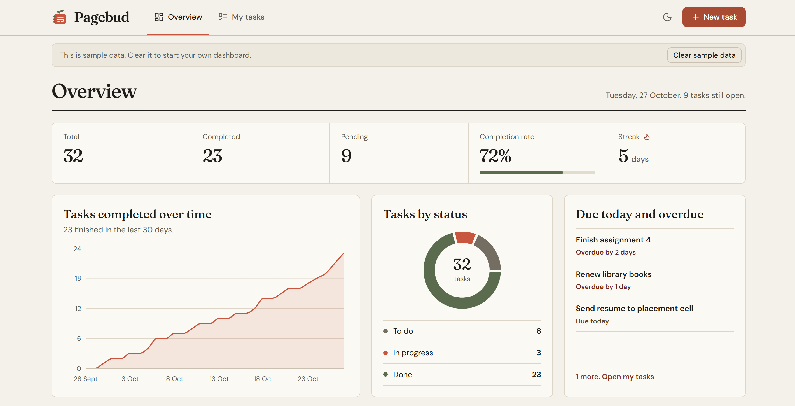
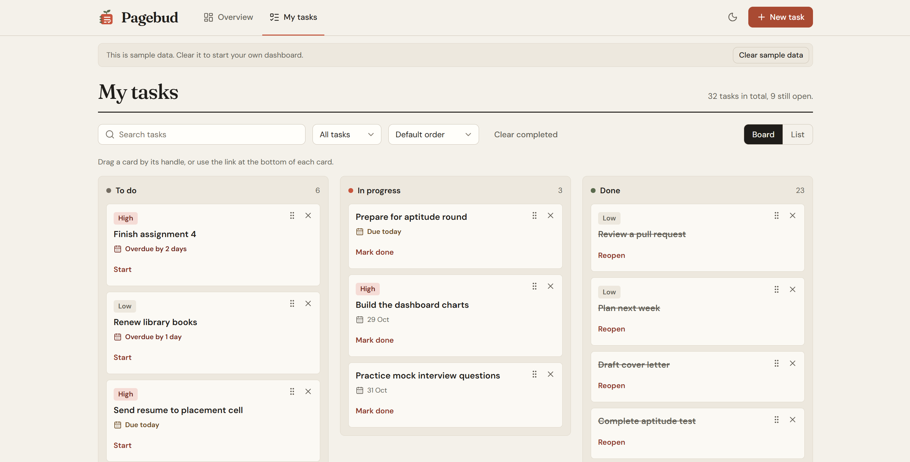
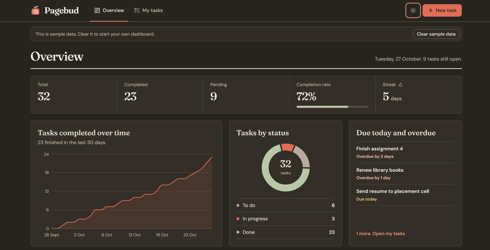
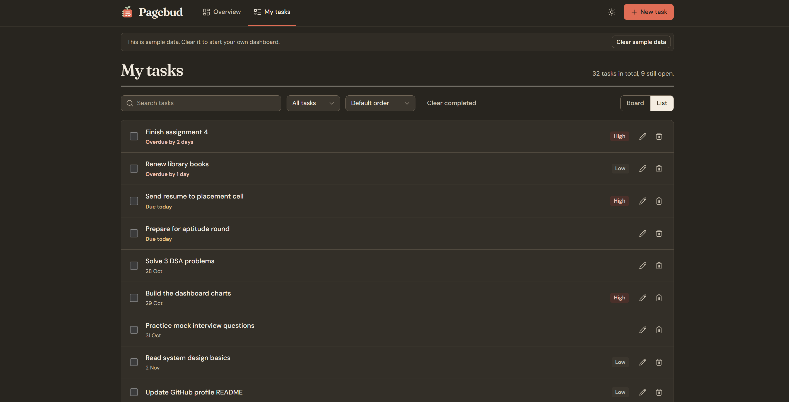

# 📒 Pagebud

A calm, lightweight task manager with a drag-and-drop Kanban board, a progress dashboard, and a focus on making daily progress visible.

**Live demo:** [pagebud-harsh-tiwari.netlify.app](https://pagebud-harsh-tiwari.netlify.app/)

**Tech stack:** React · Vite · JavaScript · CSS · dnd-kit · Recharts

---

## Preview



*Dashboard — task statistics, completion streak, and progress charts.*



*My Tasks — organize work across To do, In progress, and Done.*



*Dark mode — a comfortable alternative theme.*



*Dark mode — view and manage tasks in a clean list layout.*

---

## What is Pagebud?

Pagebud is a single-page task management app designed to help you plan work, track tasks, and understand your progress over time.

Create tasks with priorities and optional due dates, move them across a Kanban board, switch to a list view when needed, and monitor your progress from the dashboard.

Pagebud opens with sample data so you can explore its features immediately. Clear the sample data to start managing your own tasks.

**No sign-up. No complicated setup. Just your tasks and your progress.**

## The Problem

Most task managers either offer a basic checklist with little insight into progress or introduce extra complexity through accounts, teams, and extensive settings.

For students balancing assignments, DSA practice, exams, and placement preparation, it helps to know:

- What needs attention today?
- What is currently in progress?
- What has been completed?
- Am I making consistent progress?

Pagebud brings these essentials together in one lightweight interface.

## Features

### Progress Dashboard

- Overview of total, completed, and pending tasks
- Completion rate with a progress bar
- Daily completion streak
- Cumulative chart of tasks completed over the last 30 days
- Donut chart showing task status distribution
- Due-today and overdue task list, including how many days a task is late

### Task Management

- Create tasks with a title, priority, and optional due date
- Three Kanban columns: To do, In progress, and Done
- Drag-and-drop task movement between columns
- List view with checkboxes, inline title editing, and task deletion
- Search, filter by status, and sort by priority
- Start, mark done, or reopen tasks
- Clear all completed tasks in one action

### Personalization and Usability

- Light and dark themes
- Theme preference saved in the browser
- Sample data that can be cleared or restored
- Responsive layout for desktop and mobile screens
- Keyboard-accessible drag-and-drop interactions
- Accessible labels for icon buttons
- Local persistence using `localStorage`

## Tech Stack

| Technology | Purpose |
|---|---|
| React | Component-based user interface |
| Vite | Development server and production build |
| JavaScript | Application logic and state management |
| Plain CSS | Styling, responsive layouts, and theme variables |
| dnd-kit | Drag-and-drop interactions |
| Recharts | Dashboard charts |
| Lucide | Icons |
| localStorage | Persisting tasks and preferences in the browser |
| Netlify | Hosting and deployment |

No UI component library or CSS framework is used.

## Technical Highlights

- **Centralized state management:** Task state lives in the main app component and is passed to child components through props.
- **Consistent task status:** Task status and completion are updated through shared logic to keep the Kanban board, list view, and dashboard consistent.
- **Progress tracking:** Completion dates are used to calculate streaks and chart data.
- **Dynamic sample data:** Sample dates are generated relative to the current date so the demo remains relevant.
- **Theme architecture:** CSS variables control colors and other design tokens, allowing light and dark themes without duplicating the entire stylesheet.
- **Accessible interactions:** Drag-and-drop supports keyboard interaction, with alternative task actions available on cards.

## Getting Started

### Prerequisites

- Node.js and npm installed
- Git installed

### Installation

Clone the repository:

```bash
git clone https://github.com/harshtiwari-dev/pagebud.git
cd pagebud
```

Install dependencies:

```bash
npm install
```

Start the development server:

```bash
npm run dev
```

Open the local URL printed in your terminal, usually `http://localhost:5173/`.

### Production Build

To create an optimized production build:

```bash
npm run build
```

To preview the production build locally:

```bash
npm run preview
```

The production-ready files are generated in the `dist/` directory.

## Limitations and Future Improvements

- Tasks are stored in the current browser; there is no account system or cross-device synchronization.
- Only the task title can currently be edited after creation.
- Undo after deletion is not currently available.
- Recurring tasks are not currently supported.

Potential future improvements include editing task priorities and due dates, undoing deletions, and adding recurring tasks.

## Deployment

Pagebud is deployed on Netlify.

**Live application:** [https://pagebud-harsh-tiwari.netlify.app/](https://pagebud-harsh-tiwari.netlify.app/)

## Author

**Harsh Tiwari**

- GitHub: [@harshtiwari-dev](https://github.com/harshtiwari-dev)

---

